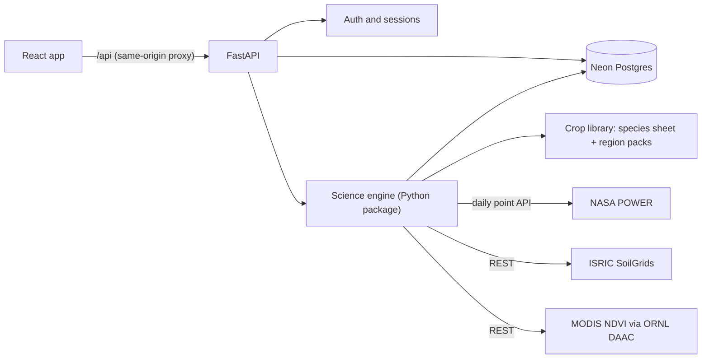
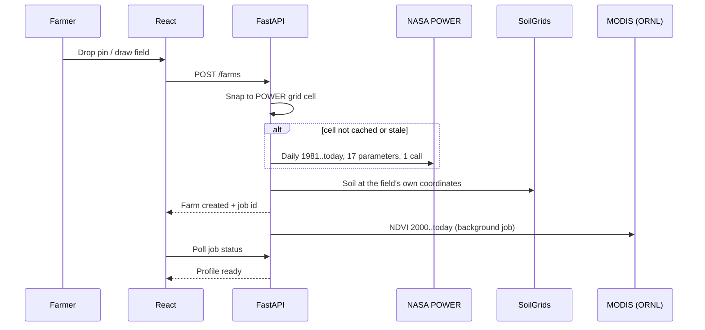

# AuraFarming — Product & Technical Plan (v1)

> NASA Space Apps Challenge 2026 · **Field Shift: Adapting Farms with NASA Data**
> Original agreed plan: Oct 15 2026, with subsequent implementation notes. Some sections retain proposals.
> Current as-built behavior: [presentation guide](PRESENTATION_GUIDE.md) and [research/decision record](RESEARCH_AND_DECISIONS.md).

---

## 1. Goal

**Challenge:** build a decision-support tool that uses NASA Earth observations together with local soil information,
crop characteristics and farmer priorities to help farmers explore crop-rotation strategies that strengthen soil
health and adapt their farms to changing conditions.

**Our promise to a farmer:**

> "Given my soil, my water, what I grew last and what I care about — what should I sow next, which 2-year rotation
> fits my farm, and how likely is it to work in a dry year or a hotter future?"

Every answer is backed by numbers and probabilities computed from ~45 years of NASA data for the farm's location.

---

## 2. MVP scope

| In v1 | Later |
|---|---|
| Web app (mobile-first), English, Hindi and Telugu, email + password login with password reset | Phone OTP, email verification |
| Several farms per user; a farm = one field with a location (pin or boundary) | Multi-field farms, automatic field boundaries |
| India crop pack (~27 crops: field crops + vegetables), Telangana as pilot area | More region packs (e.g. Kenya, US Midwest, Brazil) |
| Climate & soil profile, season tracker, vegetation history — **for any location worldwide** | Weather forecasts, email/push alerts |
| History journal with satellite-suggested dates | Photo uploads for pest/disease problems |
| Next-crop advisor, rotation explorer, compare, stress tests | Future-climate projections (NEX-GDDP-CMIP6), LLM narration |
| Rain-fed / protective / full irrigation options | Detailed irrigation scheduling, flooded-rice (paddy) mode |

**Out of scope:** perennial crops (sugarcane, orchards, coffee), pesticide/chemical recommendations, price forecasting.

---

## 3. Decisions

| Topic | Decision |
|---|---|
| Frontend | React + Vite (TypeScript recommended) |
| Backend | FastAPI (Python) — serves the API and hosts the science engine |
| Database | Neon (serverless Postgres, free tier) |
| Auth | Email + password (Argon2id hashes, HttpOnly session cookie) |
| Language | English, Hindi, Telugu (switcher in the header, remembered per browser); every UI string goes through i18n keys, and `npm run check:locales` checks the translations are complete |
| Crops v1 | ~27 crops for India: field crops + broad vegetables |
| Region strategy | One global engine + per-region "crop packs"; India first |
| Units | Hectares/acres toggle; °C; mm |

---

## 4. What the app does (by screen)

### 4.1 Account
- Sign up, log in, log out (email + password).
- Settings: change password, export my data, delete my account.

### 4.2 Onboarding — "Add a farm"
1. **Locate:** search a place, drop a pin, or draw the field boundary on a map.
2. **Auto-build profile** (progress indicator): NASA POWER weather 1981→today, SoilGrids soil, MODIS vegetation history.
3. **Soil check:** show the satellite/soil-map estimate (texture, water-holding capacity); farmer confirms or picks soil
   type (black / red / alluvial …) and depth (shallow / medium / deep); optional Soil Health Card values
   (N, P, K, organic carbon, pH, EC).
4. **Water:** rain-fed / protective irrigation (1–2 irrigations) / full irrigation; water source.
5. **Last 2–3 years of crops:** pre-filled from satellite-detected seasons; farmer confirms crop names and dates.
6. **Priorities:** sliders for Income · Water saving · Soil health · Low risk.

### 4.3 Dashboard (farm home)
- **This season:** rain since season start vs its 45-year percentile, soil-water store percentile, monsoon onset
  status, current dry-spell counter, heat days.
- **What to sow next:** top 3 options with their odds.
- **Data freshness:** e.g. "NASA POWER data up to Oct 9".

### 4.4 My Farm
- **Climate:** monthly rain vs reference evapotranspiration, dependable rainfall, onset & false-start odds, dry-spell
  odds, growing-season length, heat/frost calendar, 45-year trends.
- **Soil:** texture, water-holding capacity, organic-carbon stock, pH/CEC classes; edit/override.
- **Vegetation:** NDVI 2000→today with detected seasons (green-up, peak, harvest) and crop-vigour percentile.

### 4.5 History (season journal)
- Timeline of past seasons; add/edit records; confirm satellite-suggested dates.
- Season report card: rain percentile, dry spells, heat days, NDVI peak vs normal, actual yield vs weather-expected yield.

### 4.6 Plan
- **Next-crop advisor:** ranked options for the upcoming season using current soil water, last crop and its dates,
  irrigation and priorities; best sowing window per crop; plain-language reasons.
- **Rotation explorer:** ranked 2-year rotations with season timeline, pillar scores, key numbers, reasons, and the
  difference from current practice.
- **Compare:** 2–3 plans side by side.
- **Stress test:** +1.5 °C / +2 °C, −15% rain, driest 20% of years, late-onset years.
- Save plans.

Every number is shown as **"X in 10 years"** or a **bad / typical / good year (P10 / P50 / P90)** range, with a
confidence badge and a tooltip that defines the term.

---

## 5. How it works

### 5.1 Architecture



- The frontend host proxies `/api/*` to FastAPI, so the app is same-origin: first-party cookies, no CORS.
- The science engine is a plain Python package (numpy/pandas) inside the backend, testable without the web layer.
- Slow work (NDVI download, refreshes) runs as FastAPI background tasks. Progress lives on the record itself
  (e.g. `vegetation_series.status` and the composites saved so far), so an interrupted job resumes on the next request.
  Refresh is lazy (on access), so no always-on scheduler is needed on free hosting.

### 5.2 Flow — adding a farm



### 5.3 Flow — keeping data fresh
- Opening a farm whose POWER cell ends more than 4 days ago re-fetches the last 60 days (recent values get revised).
- NDVI refreshes when a new 16-day composite is due. Soil is static unless the farmer asks for a refresh.

### 5.4 Flow — next-crop advice
1. **Upcoming window:** from the detected season windows + region-pack season names; earliest sowing date =
   max(today, harvest of the crop still in the field + turnaround days).
2. **Current soil water:** run the daily water balance up to today using POWER near-real-time weather and the
   farmer's logged crops and dates.
3. **Candidates:** region-pack crops allowed in that window, filtered by temperature/heat/frost, pH, and water need vs
   available irrigation.
4. **Previous-crop rules** (§7.6): block, yield factor, nitrogen credit, risk flags, reasons.
5. **Simulate** each candidate × sowing week × every historical year's weather from the sowing date onward, starting
   from today's soil water — "today's state + 45 possible futures".
6. **Score** with the farmer's weights → rank → explain.

As built (`engine/planner/advisor.py`): the journal is replayed from a dry start 240 days before the season with
each past year's weather (the last column is this year), so "soil today" also has a percentile against past years.
A season the journal skips gets the pack's usual crop (India: rain-fed maize in kharif, sown on the first good rain
of its window); a "Fallow" journal entry says the field was left empty. The same replay gives the soil water shown
on the Climate tab, so both screens show one figure, with a note on what was assumed. Each crop is tried on 3
sowing dates 10 days apart and keeps the date with the best mean income; a "normal year" run (each year's own soil)
is shown next to "this year". Crops failing in ≥ 9 of 10 years are listed apart instead of ranked. The top three
also appear on the farm's home card.

### 5.5 Flow — rotation planning
1. **Slots:** 2 years of season windows (India: kharif, rabi, summer).
2. **Generate** sequences of {crops, fallow, green manure}; long crops span slots; hard constraints (calendar fit,
   water need ≤ available, rule blocks).
3. **Simulate** every candidate across all historical years, carrying soil water, nitrogen and carbon between seasons.
4. **Score** pillars → weighted total → Pareto set → robustness under scenarios → compare with current practice.

As built (`engine/planner/rotations.py`): one-year patterns (kharif + rabi + summer crop or fallow) that fit the
calendar are simulated over every agricultural year with soil water carried between seasons; the best crops per
season, the current practice, a legume and the green manure are kept, and every pair of patterns (≈ 1,000 two-year
rotations) is scored on 44 consecutive pairs of past years. Soil carbon: 24-month RothC cycle vs the current
practice (journal, else the pack default).

---

## 6. Data sources & ingestion

| Layer | Source | When fetched | Refresh |
|---|---|---|---|
| Daily weather + soil wetness, 1981→today | NASA POWER Daily API (point, community `AG`) | Farm creation, per grid cell | Lazy: last 60 days when > 4 days old |
| Soil profile, 6 depths 0–200 cm | ISRIC SoilGrids REST | Farm creation, at field coordinates | Static; farmer override |
| NDVI / EVI + quality flags, 2000→today | MODIS MOD13Q1 (250 m, 16-day) via ORNL DAAC | Background job | Every 16 days |
| Crop library | FAO-56, FAO ECOCROP, GAEZ, ICAR/ICRISAT | YAML in repo | Versioned releases |
| Prices | India MSP table + farmer override | Static | Yearly |
| Farm data | Farmer: location, soil, irrigation, history, yields | App forms | User |
| Later | Forecast (Open-Meteo/IMD, non-NASA), NASA GPM IMERG rain, NASA HLS 30 m imagery, NEX-GDDP-CMIP6, SMAP | — | — |

**Ingestion rules**
- Snap the farm to the POWER meteorology grid (0.5° lat × 0.625° lon, ~50 km). Cache key = cell; request at the cell
  centre so every farm in a cell shares one series.
- One POWER call: ≤ 20 parameters, `start=19810101` → today, JSON; replace `-999` with null.
- Parameters (17): `T2M, T2M_MAX, T2M_MIN, T2MDEW, RH2M, PRECTOTCORR, ALLSKY_SFC_SW_DWN, CLRSKY_SFC_SW_DWN,
  ALLSKY_SFC_PAR_TOT, WS2M, GWETTOP, GWETROOT, GWETPROF, EVPTRNS, EVLAND, PS, TS`.
- Store each cell as one compressed columnar blob (`bytea`): values ×100 as integers, column-wise, zstd →
  measured ~0.32 MB per cell (raw JSON 4.7 MB; one-row-per-day table ~2.1 MB).
- Retry with backoff on 429/5xx; never re-request a fresh cell (POWER may block apps that keep requesting the same
  location).
- SoilGrids: 8 properties × 6 depths. Unit conversion: `bdod` cg/cm³→g/cm³ (÷100), `cec` mmol(c)/kg→cmol(c)/kg (÷10),
  `clay/sand/silt` g/kg→% (÷10), `nitrogen` cg/kg→g/kg (÷100), `phh2o` ÷10, `soc` dg/kg→g/kg (÷10).
- MODIS: NDVI × 0.0001, fill −3000. Only the NDVI band is fetched (a quality band would double a slow download);
  cloud dips are removed by the smoother instead (§7.3). The service answers at most 10 composites per request in
  ~30 s → 3 parallel workers, newest first, saved every few chunks; the job resumes where it stopped.

**Verified live (Oct 2026, from our network)**

| Check | Result |
|---|---|
| POWER, 17 params, 1981-01-01 → 2026-10-12 | 5.3 s, 4.7 MB, one call |
| POWER latency | Weather & soil wetness ~3 days; solar starts 1984, ~5 days behind; PAR ~2.5 months behind |
| POWER metadata | Returns elevation (557 m at the pilot cell); time standard LST; fill value −999 |
| POWER units (old CSV labels were wrong) | `EVLAND` = mm/day, `EVPTRNS` = MJ/m²/day |
| POWER, 7 params, 35 years, new location | ~3.3 s |
| SoilGrids REST | ~2.5 s |
| ORNL MODIS REST | Slow: ~30 s per request of ≤ 10 composites, whatever the size; 612 composites since 2000-02-18 → ~11 min with 3 workers (the last 5 years arrive in ~2 min) |

**Storage budget — Neon Free plan** (per project: 1 GB storage, 5 GB egress/month, 100 CU-hours/month,
scale-to-zero after 5 min)

Nothing is ingested in advance except the crop library (YAML in the repo) and the demo farms' cells (seeded so the
demo never depends on live APIs). Everything else is fetched on demand when a farm is created, then cached.

| Item | Scope | Size |
|---|---|---|
| Weather + soil wetness, 17 params, 1981→today | Per grid cell, shared by every farm in it | ~0.32 MB (measured) |
| Derived climate profile | Per cell | ~10–20 KB |
| Soil profile + derived values | Per farm | ~2 KB |
| NDVI 2000→today (612 composites, JSON) | Per farm | ~12 KB (measured; Postgres compresses large values) |
| Season records | Per farm | ~1 KB each |
| Saved plans (keep the last 5) | Per farm | ~15 KB each |

| Scenario | Cells | Farms | Storage | Share of 1 GB |
|---|---|---|---|---|
| Hackathon demo | 4 | 4 | ~2 MB | < 1% |
| Telangana pilot | ~35 | 500 | ~60 MB | ~6% |
| All of India pre-ingested | ~1,000 | 5,000 | ~0.8 GB | ~80% |

- Never store raw JSON or one row per day.
- Egress is the tighter limit: one full cell read ≈ 0.32 MB → keep decoded series in an in-memory cache in the
  backend and store derived profiles, so blobs are rarely re-read.
- Cap saved plans per farm; evict cells that no farm uses; alert when `pg_database_size()` passes 80%.
- If we outgrow it: move blobs to object storage (Neon Object Storage, 5 GB free per project, or Cloudflare R2) and
  keep only metadata in Postgres, or move to Neon Launch ($0.35/GB-month).

**Data caveats (from the review of the original CSVs)**
- POWER cells are ~50 km: rain extremes are smoothed (days ≥ 50 mm ≈ 0 every year) → use percentile thresholds;
  weaker in mountains and on coasts.
- `GWET*` are model wetness indices (root zone never below ~0.5 at the pilot site; r = 0.99 with yearly rain) →
  relative signal only. Crop decisions use our own soil-water balance.
- POWER climatology `T2M_MAX/T2M_MIN` are monthly extremes, not averages → compute climatology from daily data.
- Recent days are provisional near-real-time values.
- MODIS: cloud artefacts (e.g. NDVI 0.12 on 2024-07-11) → quality filtering; a 250 m pixel is larger than most
  smallholder fields; MODIS is near end of life → keep the vegetation source swappable (VIIRS / HLS).
- SoilGrids is a modelled map that varies over short distances (SOC 12.7 vs 14.3 g/kg between two nearby queries) →
  farmer override.
- Definitions change the numbers (dry day < 1 mm vs < 2.5 mm) → fixed per region pack, shown in tooltips.
- The yearly "longest dry spell" in the original summary was calendar-year (dominated by the dry season); in-season
  dry spells are what matter for crops.

The original CSVs in the repo root (one location, 2024 sample) are kept only as test fixtures; the app does not
depend on them.

---

## 7. Calculation engine

### 7.1 Climate

| Calculation | Method |
|---|---|
| Reference evapotranspiration (ET0) | FAO-56 Penman–Monteith from `T2M_MAX/MIN, T2MDEW, WS2M, ALLSKY_SFC_SW_DWN, PS`; Hargreaves where solar is missing |
| Growing-season windows (any location) | FAO agro-ecological-zone style: soil-water bucket ≥ 25% full **and** 15-day mean temperature ≥ 5 °C; the agricultural year starts at the least-likely growing day (handles two-season and southern-hemisphere climates); frost-free window for warm-season crops |
| Monsoon onset & false start (India pack) | First day from Jun 1 on which the 3-day rain total reaches 20 mm, with no ≥ 10-day dry spell (< 2.5 mm/day) in the next 30 days; false start = the first such event from May 15 failing that test |
| Dependable / wet-year rain | Percentiles: exceeded in 8 of 10 / 2 of 10 years |
| Dry spells | Longest run of days < 2.5 mm in crop-relevant months |
| Growing-period length | Onset → day the soil store falls below 20% |
| Heat / frost | Days beyond crop thresholds in each window; frost-free run length |
| Aridity | Rain ÷ ET0 |
| Trends | Mann–Kendall test + Sen's slope, per decade |
| This season | Percentile of season-to-date rain and soil water vs all years; analog years ("years that started like this one") |

### 7.2 Soil
- USDA texture class; field capacity, wilting point, available water capacity (and Ksat) via Saxton & Rawls (2006).
- Soil-organic-carbon stock (t C/ha) = SOC × bulk density × depth.
- pH and CEC classes. Farmer / Soil Health Card values override the map.

### 7.3 Vegetation
- Smoothing: drop cloud dips (a point ≥ 0.1 below both neighbours), interpolate, then a Savitzky–Golay filter
  (window 5, order 2) pulled towards the upper envelope, because clouds only ever lower NDVI.
- Phenology: a season is a peak ≥ 0.35 that rises ≥ 0.12 above the surrounding troughs and lasts ≥ 40 days;
  green-up and senescence at 50% of the seasonal amplitude. Estimated sowing = green-up − 25 days, harvest =
  senescence + 15 days.
- Season name (India pack) comes from the **peak month** — Jul–Nov kharif, Dec–Mar rabi, Apr–Jun summer — because
  the estimated sowing date can slip into the previous season. A crop still growing is named from its green-up.
- Peak-NDVI percentile against the same season in other years (needs ≥ 5 completed seasons). A detected season
  counts as logged when it overlaps a journal entry by ≥ 30 days; unlogged ones are offered to pre-fill the journal.

### 7.4 Crop models

FAO-56 single-coefficient daily soil-water balance, carried across seasons so crop order matters
(`engine/models/water.py`):

$$D_t = D_{t-1} - P_t - I_t + K_s\,K_c\,ET_{0,t} + DP_t$$

- $D$ = root-zone depletion, $P$ = rain, $I$ = irrigation, $K_c$ = crop coefficient by growth stage,
  $K_s$ = water-stress factor, $DP$ = drainage.
- The soil (1 m) is a root zone that deepens from 0.2 m at sowing to the crop's rooting depth at full cover, plus
  the soil below it; roots reach water stored by earlier seasons (carry-over). $p$ is adjusted for ETc (FAO-56).
- Bare soil only dries its surface layer (FAO-56 total / readily evaporable water from the topsoil), so a fallow
  conserves deeper water. Runoff and capillary rise are not modelled.
- Sowing: rain-fed and protective crops on the first day of their window with ≥ 20 mm of rain in 3 days or ≥ 50%
  stored soil water, else on the last day ("dry sowing"); fully irrigated crops on the window start. The next crop
  waits until 10 days after the previous harvest.
- Irrigation modes: none / protective (up to 2 irrigations of ≤ 75 mm in the development and mid-season stages when
  stressed) / full (refill when the readily available water is used up).
- Every past year is run separately from a dry start 150 days before the season; one vectorised run covers all
  crops × years (~0.7 s for a season).

Yield response (FAO-33) with flowering, heat and succession effects (`engine/models/crop_yield.py`):

$$Y_a = Y_m \cdot \min\left(f_{season}, f_{flowering}\right) \cdot f_{heat} \cdot f_{succession}, \qquad
f = 1 - K_y\left(1 - \frac{ET_a}{ET_c}\right)$$

- The seasonal $K_y$ is also applied to the deficit during flowering (first half of the mid-season), the most
  water-sensitive period, so a dry spell at flowering is not averaged away.
- FAO-33 fitted the linear $K_y$ response for deficits up to about 50%; below half the water need $f$ falls linearly
  to zero (otherwise a crop with $K_y$ = 0.7, e.g. groundnut, keeps 30% of its yield without water).
- Heat: each flowering day loses 0–100% as Tmax rises from the crop's critical temperature to 6 °C above it.
- A season "fails" below half the attainable yield.
- **Nitrogen:** recommended N − the previous legume's credit (scaled by what happened to its residue, crop directly
  after only) + ~20 kg N/ha when residue with C:N > 30 was ploughed in < 30 days before sowing.
- **Soil carbon:** RothC-26.3, monthly (clay, temperature, rain, ET0, soil cover); carbon inputs from yield via
  harvest index, a 0.25 below-ground share and residue management. Today's SoilGrids stock is assumed to be in
  equilibrium with the current practice (journal, else a default), and options change inputs relative to it
  (inverse mode, as in FAO GSOCseq). In drylands (rain / ET0 < 0.65) bare topsoil may dry fully (dryland
  adjustment in the spirit of Farina et al. 2013). The band comes from P10 / P90 yields.

### 7.5 Probabilities and how we show them
- Every model runs across all historical years → distributions (P10 / P50 / P90) and event frequencies.
- Next-season odds: today's simulated soil water + each historical year's weather from today onward.
- Shown as "X in 10 years"; uncertainty made visible (with 45 years a 50% figure is about ±15 points); rounded;
  confidence badge.
- Scenarios: delta changes (+1.5 / +2 °C with ET0 and heat recomputed, −15% rain) and analog subsets (driest 20% of
  years, late-onset years).

### 7.6 Previous crop → next crop

The previous crop and its dates affect the next crop through five channels:

1. **Pests & diseases** — crop family plus cross-family host groups.
2. **Nutrients** — legumes leave nitrogen; heavy feeders use it up; cereal residue can lock it up for a few weeks.
3. **Soil water left behind** — depends on what grew and when it was harvested (simulated).
4. **Calendar** — harvest date → earliest sowing date → heat and rain risk (simulated).
5. **Residue, crop-to-crop toxicity, herbicide carry-over** — e.g. sorghum/sunflower residue, atrazine.

Rules look at the field's last 3 years of history:

| Situation | Effect in the engine |
|---|---|
| Same crop last season | Block, or yield penalty ~10–20% (tunable); always block if the farmer reported a soil-borne disease |
| Same family within its gap years | Yield penalty that shrinks with each year since |
| Shares a pest/disease host group with the last crop | Risk flag; stronger if the farmer reported that problem |
| Legume before a heavy feeder | Nitrogen credit → lower fertiliser cost |
| Cereal residue ploughed in just before sowing | Warning: temporary nitrogen lock-up |
| Residue toxic to the next crop (sorghum, sunflower) | Delay sowing or avoid small-seeded crops |
| Herbicide used last season | Block sensitive crops until the label's waiting period passes |
| Harvest date | Sets earliest sowing; water and heat then simulated from the real dates |

Each rule returns an effect **and** a plain-language reason.

### 7.7 Rotation scoring

| Pillar | Indicators |
|---|---|
| Income | Mean net value (yield × price − cost; nitrogen credit lowers cost); bad-year (P10) income |
| Water | Irrigation used; output per mm of water; share of crop water need met |
| Soil health | 10-year SOC change; nitrogen fixed; months of ground cover; crop-family diversity |
| Risk | Chance of crop failure (< 50% of attainable yield); P10 income; pest/disease flags |

$$\text{Score} = \sum_k w_k \cdot \text{Pillar}_k$$

Pillars are normalised 0–1 across the candidates; weights $w_k$ come from the farmer's sliders. Also shown: the
Pareto set (options no other option beats on every pillar), robustness (stays in the top N under every scenario),
and the difference from current practice.

As built (`engine/planner/scoring.py`):
- Income = 0.7 × mean + 0.3 × P10 net income; water = less irrigation + gross value per mm used; soil = SOC change,
  N fixed, months of cover, family diversity; risk = fewer failures + P10 income + fewer pest flags.
- Indicators on which every option ties (e.g. no irrigation when rain-fed) are left out of the pillar.
- Options failing in ≥ 9 of 10 years are not ranked, so they cannot stretch the scale.
- Reasons ("one of the most profitable / safest options") come from pillars ≥ 0.75 or ≤ 0.25, but an option is
  never "strong" on income at a loss, nor on risk if it fails in more than 2 years in 10 (80% dependability).
- Robust = rank ≤ 3 in every scenario (+1.5 °C, +2 °C, −15% rain, driest 20% of years, late-onset years for an
  upcoming kharif). Scenario rankings reuse the baseline soil indicators, so the baseline column equals the advice.

### 7.8 Explanations & confidence
- Reasons are generated from rule hits and the largest metric differences
  (e.g. "Pigeonpea leaves nitrogen for next season's sorghum").
- **Confidence badge:** High = validated region pack and no data flags · Medium = unvalidated pack, or data flags
  (mountains/coast, field smaller than a MODIS pixel, uncertain soil) · Low = no region pack (climate-only features).
- Advisory disclaimer on every recommendation.

---

## 8. Crop library

### 8.1 Two layers
- **Global species sheet** (filled once per crop): family, host groups, crop-coefficient curve and stage shape, root
  depth, depletion fraction, yield-response factor, temperature thresholds, heat-critical temperature, frost
  tolerance, pH range, nitrogen role/credit, residue C:N, residue toxicity, gap years.
  Sources: FAO-56, FAO ECOCROP, GAEZ.
- **Region pack** (per country/zone, 10–30 crops): local names, season names and windows, sowing windows, variety
  durations, attainable yields, prices, costs, common rotations and intercrops, regional pests.
  India sources: ICAR / ICRISAT / state agricultural-university package of practices, MSP, Agmarknet, DES statistics.
  Drafts for other countries can be bootstrapped from MapSPAM, global crop calendars (FAO GIEWS, MIRCA, GGCMI) and
  FAOSTAT, then reviewed by local agronomists.

Implemented as `engine/crops/species.yaml` (FAO-56 Tables 11, 12, 22 and FAO-33 Ky, with the row used per crop and
an `estimated` list for values set by analogy) and the India pack `engine/crops/india.yaml` (identity, families,
host groups, sowing windows, attainable yields, recommended N, price per kg — MSP kharif 2025-26 / rabi 2026-27,
vegetables indicative — and cost per ha excluding N, with `economics: {currency: INR, n_price_per_kg: 13,
validated: false}`; an unvalidated pack caps the confidence badge at Medium).

Species entry as stored:

```yaml
chickpea:  # by analogy with Table 11 lentil, arid region Oct/Nov 25/35/70/40
  {stages: [0.15, 0.21, 0.41, 0.23], kc: [0.40, 1.00, 0.35], root_m: 1.0, p: 0.50, ky: 0.90, heat_c: 35,
   hi: 0.40, dm: 0.90, residue_cn: 25, n_fixed: 50, n_credit: 20, estimated: [stages, ky]}
```

### 8.2 India v1 crops (~27)

| Group | Crops |
|---|---|
| Cereals & millets (Poaceae) | rice, wheat, maize, sorghum, pearl millet, finger millet |
| Pulses (Fabaceae) | pigeonpea, chickpea, green gram, black gram, lentil |
| Oilseeds | soybean, groundnut (Fabaceae); mustard (Brassicaceae); sunflower (Asteraceae); sesame (Pedaliaceae); castor (Euphorbiaceae) |
| Fibre | cotton (Malvaceae) |
| Vegetables | tomato, brinjal, chilli, potato (Solanaceae); okra (Malvaceae); onion (Amaryllidaceae); cabbage/cauliflower (Brassicaceae); bottle gourd (Cucurbitaceae) |
| Green manure | sunn hemp (Fabaceae) |

Intercrops are recorded per component (e.g. sorghum + pigeonpea, maize + pigeonpea, cotton + green gram); rules apply
to every component.

### 8.3 Families

| Family | Examples | Nutrient role | Main carry-over risk | Rule |
|---|---|---|---|---|
| Legumes | pigeonpea, chickpea, grams, lentil, soybean, groundnut, sunn hemp | Fix nitrogen; leave ~20–40 kg N/ha (green manure more) | Wilts (species-specific), root rots | Good before cereals, cotton, brassicas; don't repeat the same pulse on wilt-prone fields |
| Cereals & millets | rice, wheat, maize, sorghum, millets | Heavy nitrogen users (rice, maize); lots of high-C:N residue | Fall armyworm, stem borers, Striga weed | Follow with a legume; avoid maize after maize; sorghum residue can suppress small seeds |
| Mallows | cotton, okra | Heavy feeder; long season | Pink bollworm (survives in stalks), whitefly viruses | Never cotton after cotton; remove stalks; long crops close the next window |
| Composites | sunflower | Moderate | Residue toxic to next crop | Good post-monsoon break crop |
| Nightshades | tomato, brinjal, chilli, potato | Heavy feeders | Bacterial wilt, nematodes, leaf-curl viruses | 3–4-year gap |
| Brassicas | mustard, cabbage/cauliflower | Heavy (nitrogen, sulphur); residue helps suppress soil diseases | Diamondback moth | 2–3-year gap; good break before nightshades |
| Alliums | onion | Light to moderate; shallow roots | Thrips, purple blotch | 2–3-year gap |
| Cucurbits | bottle gourd | Moderate | Fruit fly, mildew, viruses | 2–3-year gap |
| Others | sesame, castor | Light / moderate; castor deep-rooted | Root rot (sesame), waterlogging | Rotate with legumes |

**Cross-family host groups** (family alone is not enough):

| Host group | Crops affected |
|---|---|
| Pod borer (*Helicoverpa armigera*) | cotton, chickpea, pigeonpea, tomato, sorghum, maize |
| Root-knot nematodes | tomato, brinjal, okra, cucurbits, pulses, cotton |
| Whitefly leaf-curl viruses | cotton, chilli, tomato, okra |
| Dry root rot / charcoal rot (*Macrophomina*) | chickpea, soybean, sorghum, sesame |
| Collar/stem rot (*Sclerotium rolfsii*) | groundnut, chickpea, chilli, tomato |

---

## 9. Data model (Neon Postgres)

| Table | Key columns |
|---|---|
| `users` | id, email (unique), password_hash, name, created_at, last_login_at |
| `sessions` | id, user_id, token_hash (unique), created_at, expires_at |
| `password_resets` | id, user_id, token_hash (unique, SHA-256 of a single-use 256-bit token), created_at, expires_at (30 min) |
| `farms` | id, user_id, name, lat, lon, boundary (GeoJSON), area_ha, power_cell_id, region_pack, irrigation_mode, irrigation_source, soil_override, priorities, created_at |
| `climate_cells` | id (snapped lat/lon), elevation_m, series (compressed bytea), profile (derived JSON), first_date, last_date, fetched_at, last_used_at |
| `soil_profiles` | farm_id, source, layers, derived (texture, AWC, SOC stock), fetched_at |
| `vegetation_series` | farm_id, product, series (compressed bytea), first_date, last_date, fetched_at |
| `season_records` | id, farm_id, season_name, season_year, crops [{crop_id, share}], sow_date, harvest_date, status (planned / in_field / harvested), residue, irrigations, yield_kg_ha, fertiliser, herbicides, problems, source (farmer / satellite), notes |
| `plans` | id, farm_id, kind (next_crop / rotation), title, inputs, option (the chosen result), engine_version, created_at (max 20 per farm) |
| `jobs` | id, farm_id, kind, status, progress, error, created_at, finished_at |

The crop library and region packs are versioned YAML files in the repo, loaded at startup (not stored in the DB).

---

## 10. API (FastAPI, `/api/v1`)

| Method | Path | Purpose |
|---|---|---|
| POST | `/auth/register` | Create account |
| POST | `/auth/login` | Start session (sets cookie) |
| POST | `/auth/logout` | End session |
| GET | `/auth/me` | Current user |
| GET, POST | `/farms` | List farms / create farm (starts data jobs) |
| GET, PATCH, DELETE | `/farms/{id}` | Farm details / edit / delete |
| GET | `/farms/{id}/sources` | Weather verification/year progress, soil source and satellite progress/dates |
| GET | `/farms/{id}/climate` | Climate risk profile |
| GET | `/farms/{id}/season` | This-season tracker |
| GET, PATCH | `/farms/{id}/soil` | Soil profile / farmer override |
| GET | `/farms/{id}/vegetation` | NDVI history + detected seasons |
| GET, POST | `/farms/{id}/seasons` | History records |
| PATCH, DELETE | `/seasons/{id}` | Edit / delete a record |
| POST | `/farms/{id}/advice/next-crop` | Ranked next-crop options |
| POST | `/farms/{id}/advice/rotations` | Ranked 2-year rotations |
| POST | `/farms/{id}/advice/stress-test` | Scenario comparison |
| GET, POST | `/farms/{id}/plans` | Saved plans (POST recomputes and stores the chosen option) |
| DELETE | `/farms/{id}/plans/{plan_id}` | Delete a saved plan |
| GET | `/crops?region=IN` | Crop pack for a region |
| GET | `/farms/{id}/crop-fit?season=&irrigation=` | Every pack crop simulated for the coming season across past years |
| GET | `/account/export` | Download all of the user's data as JSON |
| POST | `/account/password` | Change password (signs out other sessions) |
| POST | `/account/delete` | Delete the account and everything in it (password required) |
| POST | `/auth/password/forgot`, `/auth/password/reset` | Email a reset link (same answer whether or not the account exists); set a new password and sign out everywhere |
| PUT, DELETE | `/farms/{id}/soil/override` | Save / clear the farmer's soil values (type, texture, water held, depth, organic carbon, pH) |

---

## 11. Frontend

- **Stack:** React + Vite, React Router, TanStack Query, Tailwind CSS + shadcn/ui, Apache ECharts (probability bands,
  calendars), MapLibre GL + a drawing tool (pin/boundary), react-hook-form + zod, react-i18next.
- **Pages:** Landing · Sign up · Log in · Onboarding wizard · Dashboard · My Farm (Climate, Soil, Vegetation) ·
  History · Plan (Next crop, Rotations, Compare, Stress test) · Settings.
- **UI principles:**
  - Mobile-first, plain language, one key number per card plus "why".
  - Probability bands, season calendars and percentile gauges instead of raw tables.
  - Colour-blind-safe palette; WCAG 2.1 AA.
  - Progress and skeleton states while farm data is built.
  - Data source and "last updated" on every chart; definitions in tooltips.

---

## 12. Security & privacy

- **Passwords:** Argon2id; minimum length 10; rate-limited register/login; generic "invalid email or password"; no
  user enumeration.
- **Sessions:** random token stored hashed; cookie `HttpOnly; Secure; SameSite=Lax`; expiry and server-side logout;
  CSRF protection (Origin check + token) on every state-changing request.
- **Input & data:** Pydantic validation on every input; SQLAlchemy parameterised queries; least-privilege DB role;
  secrets only in environment variables; HTTPS everywhere; same-origin API (no open CORS); security headers.
- **Privacy:** farm locations are personal data — owner-only access, export and delete account, no third-party
  sharing (aligned with India's DPDP Act and GDPR principles).
- **Supply chain:** dependency and secret scanning in CI.
- **Advice safety:** advisory disclaimer; no pesticide recommendations in v1.

---

## 13. Worldwide strategy

- **Global from day 1:** climate profile, season windows, risk odds, season tracker, soil card, vegetation history.
- **Crop advice:** only where a region pack exists (India in v1); elsewhere "climate-only" with a Low confidence badge.
- **One generic season detector, tested on four climates (35 years of POWER data each):**

| Location | Climate | Detected growing window(s) | Example probability |
|---|---|---|---|
| Telangana, India | Monsoon | Jun 22 – Nov 6 | A season of at least 90 days in 76% of years |
| Machakos, Kenya | Two rainy seasons | Apr 4 – May 28 and Nov 3 – Dec 31 | Both seasons reach 60 days in only 21% of years |
| Mato Grosso, Brazil | Southern hemisphere | Oct 1 – May 21 (crosses New Year) | Median 235 days (room for soybean then maize) |
| Iowa, USA | Temperate | Mar 28 – Nov 3 | Frost-free only ~171 days → needs frost logic |

- **Before adding temperate regions:** frost-based windows for warm-season crops, winter crops (dormancy,
  vernalisation), real soil depth (a generic 100 mm store wrongly splits Iowa summers in ~1 in 5 years).

| Part | India | Worldwide |
|---|---|---|
| Data ingestion | Low | Low |
| Season & risk engine | Low | Medium |
| Water / yield / carbon models | Medium | Medium |
| Crop library | Medium | High |
| Pest & succession rules | Medium | High |
| Validation | Medium | High |
| Localisation | Medium | High |
| Prices | Low | Medium |
| Legal / privacy / pesticides | Low–Medium | High |
| App, auth, UI | Same | Same |

The bottleneck for worldwide quality is agronomic knowledge and local validation, not NASA data or code.

---

## 14. Prototype findings (real data)

Pilot location: **17.0°N, 78.125°E** (near Shadnagar, ~55 km SW of Hyderabad, Telangana). NASA POWER 1981–2025
unless stated.

**Climate**

| Insight | Value |
|---|---|
| Yearly rain | Median 761 mm; dependable (8 in 10 years) 665 mm; wet year (2 in 10) 920 mm; CV 22%; range 466 mm (2018) – 1,188 mm (2025) |
| Weak monsoon (Jun–Sep < 75% of median) | 18% of years |
| Onset | Median Jun 16; by Jun 30 in 67% of years; after Jul 15 in 20%; 2026 onset Jun 14 |
| False start | 24% of years — the first big rain is not a safe sowing signal |
| Jul–Sep dry spell (< 2.5 mm/day) | ≥ 10 days: 71% · ≥ 14 days: 33% · ≥ 21 days: 11% (with < 1 mm: 44% / 11% / 2%) |
| Growing-season length (127 mm soil store) | Median 148 days; ≥ 180 days in only 13% of years |
| Late post-monsoon heat (≥ 5 days ≥ 35 °C, Feb 15–Mar 15) | 98% of years → sow rabi crops early |
| ET0 / aridity | ~1,965 mm/yr; rain ÷ ET0 = 0.39 (semi-arid) |
| Trends | No significant trend in rain (p = 0.91), onset or season length; nights warming +0.1 °C/decade (p = 0.03); days ≥ 40 °C fell ~4/decade (p = 0.02, to be validated) |
| Note | The 2015–2025 file made rain look more variable (CV 30%) and trending wetter; the 45-year record shows variability, not a trend |

**Soil (original SoilGrids sample)** — clay loam to 60 cm (clay 29→39%), pH 6.6–6.8, CEC ~25 cmol/kg, SOC 1.43% at
the surface → 0.67% at 30–60 cm, ~48 t C/ha in 0–30 cm, plant-available water ~127 mm per metre (Saxton–Rawls).

**Soil changes the answer** (same weather):

| Soil | Median season | Season ≥ 150 days | Season ≥ 180 days (two rain-fed crops) |
|---|---|---|---|
| Shallow red (75 mm) | 115 days | 20% | 0% |
| Clay loam (127 mm) | 148 days | 47% | 13% |
| Deep black (200 mm) | 162 days | 60% | 38% |

**Previous crop changes the next crop** (rain-fed chickpea after different monsoon crops, 45 seasons):

| Previous crop | Typical harvest | Chickpea sown | Soil water at sowing | Water need met (median) | Years ≥ 60% met | Heat at pod-fill |
|---|---|---|---|---|---|---|
| Fallow | – | Oct 10 | 109 mm | 51% | 33% | 0% |
| Green gram (70 days) | Aug 22 | Oct 10 | 109 mm | 51% | 33% | 2% |
| Soybean (100 days) | Sep 21 | Oct 11 | 103 mm | 45% | 29% | 9% |
| Maize (110 days) | Oct 1 | Oct 11 | 103 mm | 45% | 27% | 11% |
| Cotton (170 days) | Nov 30 | Dec 7 | 11 mm | 8% | 0% | 89% |

Long-duration crops close the post-monsoon window; between short crops the family/pest/nitrogen rules decide.
(Prototype model from before the crop engine; superseded by the crop fit below.)

**Crop fit (crop engine, 45 seasons 1981–2025, clay loam 128 mm/m, after the logged soybean):**

| Season | Result |
|---|---|
| Rabi, rain-fed | Sorghum fails 13 of 45 seasons (median 2.0 of 3.5 t/ha), finger millet and chickpea 14 (chickpea 1.0 of 1.8 t/ha, 54% of water need met), mustard and sunflower 22, maize 36; wheat, lentil, groundnut, rice and most vegetables fail every season |
| Rabi, full irrigation | Wheat ~4.0 t/ha with ~7 irrigations (~450 mm); chickpea ~1.7 t/ha with ~230 mm |
| Kharif, rain-fed | Sowing follows the monsoon (median Jun 18). Sorghum, maize, millets, oilseeds, soybean and cotton stay above half their attainable yield every season; pigeonpea fails 3, non-flooded rice 9, chilli 20. The worst sorghum seasons are 2018, 1994, 2004 and 2009 |
| Soil carbon, 10 years | Adding a rabi crop to the default practice (maize, residue removed): +3 to +7 t C/ha with residue left, about half that if removed (chickpea +3.9 / +2.7) |

Kharif failures are probably understated: POWER rain is a ~50 km average with fewer dry days than a field sees, and
pests, waterlogging and false-start re-sowing are not modelled. Crop parameters still need local validation.

**Planner (Oct 16 2026, rabi 2026, rain-fed, after soybean kharif 2025, nothing logged for 2026):** soil water today
81 mm (63% of 128 mm) — drier than 96% of past years on this date. 11 crops fail in ≥ 9 of 10 years and are not
ranked; the top options (sunflower, finger millet, sorghum, all sown now) still fail about 6 in 10 years, so the
screen shows a hard-season warning. Rotations from kharif 2027: bottle gourd + a rabi millet/oilseed beats the
default maize practice on profit and soil carbon (+3.8 t C/ha in 10 years) but fails 28% of seasons vs 2%.
Response times: next-crop 1.2 s, rotations 5 s, stress test 1–4 s. Without the 50% limit on the Ky response,
rain-fed rabi groundnut "failed every year" yet still showed ₹13,700/ha profit — the reason for the fix in §7.4.

**This season (2026, up to Oct 9):** rain since Jun 1 = 406 mm vs median 637 mm (drier than 93% of past seasons);
root-zone store 24% full (drier than 96% of past seasons on this date) → a rain-fed rabi crop is high-risk this year.

**Vegetation (MODIS, 612 composites 2000–2026, 250 m pixel at the pilot point):** one kharif crop every year (26
completed seasons + 2026 still growing) and no rabi crop in any year — consistent with the 148-day median growing
season. Median green-up Jul 19, about a month after the median onset; peak NDVI 0.53–0.77. The 2002 and 2009
drought years are among the four weakest seasons, but 2018, the driest year here (466 mm), still peaked high (0.75):
one pixel's greenness also reflects irrigation and land use, so it supports the journal and never replaces it.

---

## 15. Repository layout

```
AuraFarming/
├─ backend/
│  ├─ app/              # FastAPI: main, routers, auth, db, schemas
│  ├─ engine/
│  │  ├─ ingest/        # power, soilgrids, modis, cache
│  │  ├─ climate/       # et0, seasons, risk, trends
│  │  ├─ soil/          # pedotransfer, carbon stock
│  │  ├─ vegetation/    # quality filter, phenology
│  │  ├─ crops/         # loader + validation, species.yaml, india.yaml
│  │  ├─ models/        # water balance, yield, nitrogen, rothc
│  │  └─ planner/       # rules, common, outcomes, cropfit, advisor, rotations, scoring, scenarios
│  ├─ migrations/       # Alembic
│  └─ tests/
├─ frontend/
│  └─ src/              # pages, components, features, api, i18n
├─ docs/PLAN.md
└─ *.csv                # original 2024 sample (test fixtures only)
```

Use a project virtual environment for Python (`python -m venv .venv`).

---

## 16. Build phases (in order; each ends with something demoable)

**Status (Oct 2026):** phases 1–6 run locally on SQLite (latest validation in the QA report). Phase 6 delivered the planner: next-crop
advice from today's soil, two-year rotations vs current practice, priority sliders, stress tests, compare, saved
plans and confidence badges ("Plan" tab). Since then: Hindi and Telugu, account settings (change password, export,
delete) and password reset by email, a map on Add farm (OpenStreetMap streets, place search, pin or drawn boundary
that sets the centre and area), farmer soil values used by every model, one journal-based soil-water figure on
the Climate and Plan tabs, a top-3 home card, and the source of every default price (MSP or indicative). Still open:
the Neon connection, CI and deployment (phase 1), analog years (phase 3), and native-speaker review of the Hindi and
Telugu text. Next: phase 7; recent weather is unresolved, with the explicit limited-advice policy below.

**23 October QA remediation:** migration 0005 adds weather quality, dataset revisions and annual checkpoints.
Annual LST downloads validate units, coverage, missingness, physical bounds and monthly rainfall/EVLAND consistency;
failed years fall back to month-sized daily downloads with the same checks. Recent incomplete months require a
short-window comparison. Only a fully checked history is published atomically. Legacy/suspect cells cannot bypass
server-side guards through cached climate/advice results; snapshots retain their source revision and warning status.
Mobile navigation/tabs, neutral tied scores, absolute failure/loss warnings, reset delivery messages, map area reset,
saved boundaries, farmer soil/fallow provenance, residue translations and source progress are implemented.

**Recent weather unresolved:** every local cell has 45/46 years checked. Recent 2026 GEOSIT evaporation fails even one-day checks;
all five remain quarantined and their old blobs are preserved. No trusted current-weather advice is claimed. The checked 2024
Warangal candidate is 1,112.89 mm versus the old 26,709.36 mm. Full evidence and retry instructions are in
[QA-2026-10-23.md](QA-2026-10-23.md) and the README. NASA monthly data is a consistency reference, not independent truth.

**Availability revision (23 October):** the user approved opening advice with Low confidence and an information
explanation. With at least 30 consecutive checked complete years through last December, supported-region farms use
those checkpoints and a calendar-matched previous-year scenario for recent state replay. Historical trials never
include substituted days. Farm status is `limited`; Plan opens independently of Climate/Crop fit. All advice APIs
and saved plans carry weather provenance; repairing weather does not silently upgrade old scenarios. This supersedes
the earlier blanket advice block, not weather validation. See the two as-built guides linked at the top.

1. **Foundations** — repo layout, FastAPI skeleton, React + Vite skeleton, Neon + Alembic, CI (lint + tests),
   `/api` proxy. *Done when* a deployed page calls the API and reads from the database.
2. **Data layer** — POWER client with cell cache and lazy refresh; SoilGrids client with unit conversion; MODIS
   background job; tests against recorded responses. *Done when* any lat/lon returns cached weather, soil and NDVI.
3. **Analytics** — ET0, season windows, onset/false start, dry spells, growing-period length, heat/frost,
   percentiles, trends, analog years; Saxton–Rawls; phenology. *Done when* the §14 numbers are reproduced by tested
   engine code.
4. **Accounts, farms & history** — auth, onboarding wizard, My Farm screens, dashboard tracker, history journal with
   satellite-suggested dates.
5. **Crop library & models** — India pack (~27 crops, sourced); water balance with carry-over, yield, nitrogen,
   RothC; succession rules.
6. **Planner** — next-crop advisor, rotation explorer, compare, stress tests, explanations, confidence badges, saved
   plans.
7. **Polish & demo** — UI polish, accessibility, vectorised simulations for speed, deployment, demo farms
   (Telangana + Kenya / Iowa / Brazil), judge script.

---

## 17. Testing & validation

- **Unit:** ET0 vs FAO-56 Example 18 (Brussels, 6 July → 3.9 mm/day); Saxton–Rawls reference values; water-balance
  mass conservation; onset / dry-spell / run-length functions on synthetic series; every succession rule.
- **Integration:** ingestion clients against recorded responses; the original 2024 CSVs as fixtures.
- **API:** pytest + httpx, including auth flows and rate limits.
- **Frontend:** Vitest + React Testing Library; Playwright end-to-end (sign up → add farm → history → advice).
- **Science:** simulated yields vs district statistics; satellite-detected vs farmer-logged dates; agronomist review
  of the India pack and rules.

---

## 18. Risks & mitigations

| Risk | Mitigation |
|---|---|
| Confidently wrong advice | Ranges instead of single numbers, confidence badges, disclaimers, agronomist review, conservative defaults |
| API limits or outages (POWER, SoilGrids, ORNL) | Cache per cell/farm, retries with backoff, serve stale data with "last updated" |
| Coarse data vs small fields | Farmer overrides (soil, dates), data-quality flags |
| MODIS end of life | Swappable vegetation source; VIIRS / HLS next |
| Free-tier limits (storage, egress, compute hours, sleeping hosts) | ~0.32 MB compressed blob per cell, in-memory cache, derived profiles, lazy refresh, no always-on workers |
| Slow simulations | Vectorise across years with numpy; filter candidates by rules first; cache profiles |
| Scope creep | v1 list in §2 is frozen; extras go to §19 |

---

## 19. Later / stretch

Weather forecasts · NASA GPM IMERG rainfall · NASA HLS 30 m imagery · NEX-GDDP-CMIP6 future climate · Telugu/Hindi ·
phone OTP · password reset & email verification · photo uploads · alerts · more region packs · LLM narration ·
offline PWA · flooded-rice mode · ENSO-conditioned odds.

---

## 20. Demo script

1. Sign up → add a farm near Shadnagar, Telangana → profile builds from NASA POWER, SoilGrids and MODIS.
2. **Know your season:** dependable rain, onset and false-start odds, dry-spell odds, season length.
3. **This season:** 2026 is among the driest 7% → soil water is low.
4. **History:** satellite-detected seasons → farmer confirms "soybean, Jun 15 – Sep 20".
5. **Next crop:** ranked options with odds and reasons (water, heat, family rules).
6. **Rotation explorer:** raise "Soil health" → the plan changes; stress test at +1.5 °C.
7. **Worldwide:** open the Kenya, Iowa and Brazil demo farms → season windows detected automatically.

---

## 21. Glossary

| Term | Meaning |
|---|---|
| Kharif / Rabi / Summer (Zaid) | Indian monsoon (Jun–Oct) / post-monsoon winter (Oct/Nov–Mar) / summer (Mar–Jun) seasons |
| ET0 | Reference evapotranspiration — water a reference grass crop would use |
| AWC | Available water capacity — water the soil can hold for plants |
| Growing period | Days when both moisture and temperature allow crops to grow |
| Onset / false start | Reliable start of the rains / first big rain followed by a long dry spell |
| NDVI | Satellite greenness index |
| P10 / P50 / P90 | Bad-year / typical / good-year values |
| RothC | Rothamsted soil-carbon model |
| Pareto set | Options that no other option beats on every pillar |
