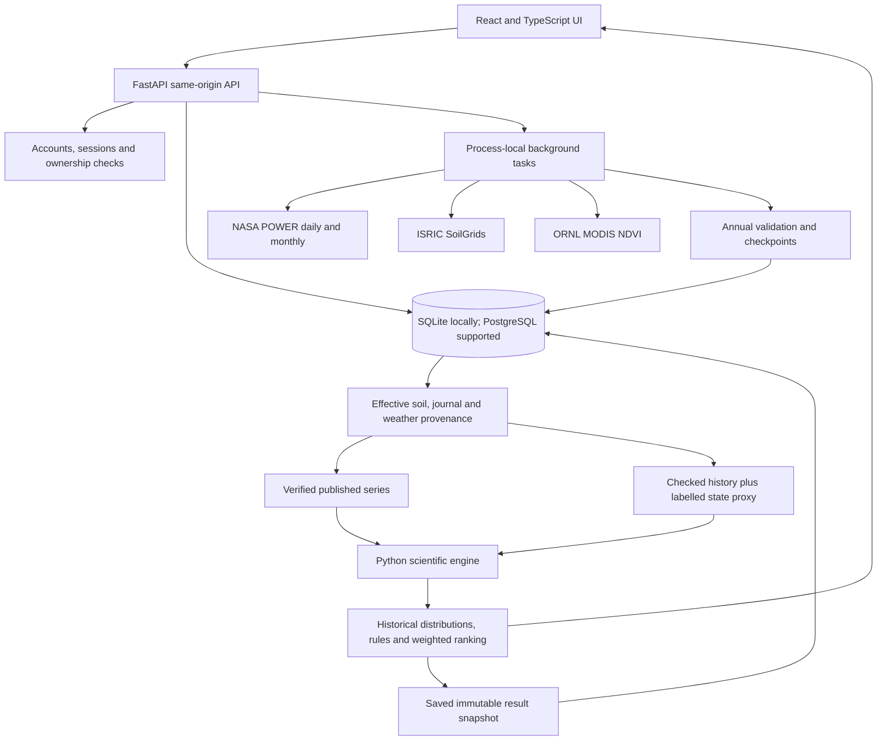

# CropCompass: Research Notes and Design Decision Record

As-built snapshot: 23 October 2026. Purpose: support a research-paper methods section and preserve the major
product, scientific and implementation decisions made during development.

This is a traceable engineering record, not a peer-reviewed validation study. Rationale below describes recorded
choices and their observable trade-offs; it is not a verbatim transcript of every discussion. The original
[PLAN.md](PLAN.md) includes proposals and historical assumptions. For exact current ingestion triggers and a demo
script, use [PRESENTATION_GUIDE.md](PRESENTATION_GUIDE.md).

## 1. Research Positioning

### Suggested Working Title

**CropCompass: A Provenance-Aware Crop-Rotation Decision-Support Prototype Combining Earth Data, Farmer History
and Multi-Criteria Simulation**

### Accurate System Description

CropCompass is a web-based, deterministic decision-support prototype integrating gridded weather, mapped soil,
satellite vegetation history and farmer-provided management records. A Python engine simulates crop-water and
yield responses across historical weather windows, applies crop-succession rules, estimates indicative economic
and soil-carbon outcomes, and ranks plans using farmer-defined priorities. Data-quality metadata and scenario
provenance are retained separately from recommendation scores.

The current application does not train a machine-learning model, use an LLM to recommend crops, forecast weather,
identify crop species from imagery, or optimise farm management using field-calibrated predictive accuracy.
The India crop/economic pack is explicitly unvalidated. Region-independent analytics do not imply validated
agronomic recommendations worldwide.

### Candidate Research Questions, Not Established Findings

1. Does combining farmer history with explicit soil-water carry-over change recommended crop sequences compared
   with climate-only suitability?
2. How stable are rankings to soil assumptions, farmer priorities and weather perturbations?
3. Can users distinguish relative rankings, historical event frequencies and data confidence?
4. How does a clearly disclosed historical-state fallback affect recommendation quality and user interpretation
   during upstream-data failures?
5. Does checkpointing reduce repeat ingestion cost while preserving traceability after interrupted downloads?

## 2. Evolution of the Decisions

| Stage | Major decision / observation | Current status |
| --- | --- | --- |
| Initial exploration | Root CSVs used to inspect one Telangana location and data semantics | Fixtures only; not the live data store |
| 15 October plan | Global engine, regional crop packs, farmer priorities, React/FastAPI, planned Neon deployment | Architecture retained; Neon deployment unverified |
| 16 October implementation | Local phases 1-6, accounts, farms, journal, climate/soil/vegetation, crop models and planner | Implemented locally |
| Usability expansion | Hindi/Telugu, account control, map/boundary, soil overrides, consistent journal-based soil water | Implemented; native-speaker and accessibility review still open |
| 23 October QA | Some full-history POWER rainfall and EVLAND differed by 24x from shorter requests | Observed upstream response inconsistency; exact provider cause unresolved |
| Initial remediation | Annual downloads, monthly checks, checkpoint repair, revision-aware caches; block advice until verified | Validation retained; blanket advice blocking superseded below |
| Availability revision | User explicitly requested usable advice with a Low confidence tag and explanation | Historical-reference planning enabled; suspect observations still quarantined |

The last change is a product-policy decision, not evidence that the upstream defect was corrected. No published
weather dataset is reclassified as verified merely to make the UI usable.

## 3. Architecture and Data Flow

The scientific engine is separate from HTTP/authentication and can be tested with synthetic inputs. SQLAlchemy
and Alembic manage persistence. Migrations 0001-0005 cover the implemented evolution, including plans, account
features and weather-quality checkpoints. No migration is needed for the latest fallback: provenance uses existing
JSON plan inputs and dynamically generated API metadata.

Background tasks are not a durable worker service. Annual and NDVI checkpoints survive a restart, but work needs
a later request/refresh to resume. Locks, throttles and caches are per process. The current ingestion deployment
assumption is one API worker, not distributed concurrency safety.

## 4. Data and Provenance

The full variable inventory and event/refresh matrix are in [PRESENTATION_GUIDE.md](PRESENTATION_GUIDE.md).

### Weather

- Request 17 daily POWER variables at a snapped meteorological grid location, from 1981 onward, using `AG` and LST.
- Replace provider fill values with missing values; retain advertised units and provider header provenance in
  annual checkpoints. POWER combines source products; it is not all direct satellite observation or all MERRA-2.
- Use annual daily requests, with month-bounded recovery if validation fails. Recent partial months require
  additional short-window agreement; completed months are checked against POWER monthly rates.
- Check exact date coverage, units, finite values, missingness, broad physical bounds and temperature ordering.
- Permit explicitly recognised early solar gaps before 1984 and recent solar-product latency. These exceptions
  are not permission to accept arbitrary missing rainfall.
- Convert monthly mean daily rainfall/EVLAND rates to totals using calendar month length. The implemented
  rounding tolerance is $0.011d + 0.1$ mm for a month with $d$ days.
- Store x100 integer, column-oriented, zstd-compressed series. Precision is quantised to 0.01 of the input unit;
  this is not lossless preservation of the original HTTP response.
- Commit each valid year separately. Publish a new full series and UUID revision atomically only after the full
  required span passes. Retain previous data if the replacement fails.

Same-provider monthly consistency is not an independent accuracy assessment. Five audited cells are not a globally
representative validation sample. Physical bounds may need regional calibration and must be versioned if changed.

### Soil

SoilGrids mean predictions are fetched for eight properties at six depths, converted using advertised factors and
summarised. Effective soil combines farmer overrides with mapped/default parameters through one shared service,
so the climate and planner do not silently use different soil assumptions. A mapped profile is not a laboratory
measurement. Static soil is not repeatedly fetched on every page view or every refresh.

### Vegetation

MOD13Q1 NDVI is fetched for a single farm-coordinate pixel, not averaged across the drawn polygon. Only NDVI is
downloaded; no quality-assurance band or EVI is ingested. A cloud-dip heuristic, interpolation and Savitzky-Golay
smoothing estimate the seasonal curve. Green-up, peak and senescence yield suggested sowing/harvest dates.
This is heuristic phenology, not supervised crop classification or validated cloud-quality screening.
Satellite suggestions do not automatically modify the journal or directly update the planner's soil-water state.

### Farmer and Knowledge Inputs

The journal records crop IDs, dates, status, residue, irrigation count, yield, problems and herbicide information.
Planned records are not treated as completed history. Explicit Fallow is distinct from a missing record.
Species and region YAML files provide physiological parameters, families, cross-family host groups, sowing windows,
attainable yields, prices and costs. Fields estimated by analogy are identified in the species sheet.
Prices are static MSP references or indicative values, not a live price prediction; a price-override workflow was
proposed but is not part of the implemented frontend described here.

## 5. Methods Implemented

### 5.1 Climate and Soil State

Reference evapotranspiration uses FAO-56 Penman-Monteith when the required weather is available, with Hargreaves
fallback for missing radiation. Daily climate supports monthly summaries, dependable rainfall, heat/frost metrics,
dry spells, season windows and trends. Sen's slope and Mann-Kendall are used for trend description, not causal attribution.

Soil texture and hydraulic properties use Saxton-Rawls-style pedotransfer functions. Available water is combined
with rootable depth; SOC stock uses concentration, bulk density and depth. These estimates inherit map and parameter
uncertainty. The FAO-56-style water balance includes expanding roots, deeper water storage, bare-soil evaporation,
drainage and irrigation modes. Runoff, capillary rise and flooded paddy dynamics are not modelled.

### 5.2 Previous Crop and State Replay

The next-crop advisor replays the recent journal over a 240-day lead-in from a dry initial state. This provides
soil-water carry-over and determines whether an existing crop delays sowing. Missing journal seasons use the India
baseline practice (maize in kharif); recorded Fallow suppresses an assumed crop for the covered interval.
History is applied to repeated weather trials as a management scenario, not as observed management for every past year.

Succession rules inspect crop identity, families and shared pest-host groups, legume credits, high-C:N residue,
reported problems, toxic residues, herbicide waiting periods and the calendar. They return reasons and constraints,
not an epidemiological disease probability. Multi-crop journal entries can inform rules, but crop-water replay uses
a selected main crop; this is not a full mechanistic intercrop-competition model.

### 5.3 Yield, Economics and Carbon

FAO-33-style water response is modified by flowering deficits, heat and succession effects. The limiting seasonal
or flowering response is used rather than letting a short critical drought disappear into a seasonal average.
The low-water response is extended conservatively toward zero; this is an implementation adaptation needing validation.
Failure is defined as simulated yield below half the attainable yield, not a directly observed farm bankruptcy event.

Income uses simulated yield times static price minus indicative costs, with nitrogen-credit adjustments. Reported
quantiles primarily represent weather variability, not a complete uncertainty distribution over price, costs and
model parameters. Negative mean income is displayed as a loss, not hidden behind a relative score.

Soil carbon uses a monthly RothC-style model, equilibrium assumptions for current practice, yield-derived residue
inputs and a dryland bare-soil adjustment. It is an indicative comparison, not a measured sequestration result or
carbon-credit estimate. Next-crop carbon comparisons and two-year rotation carbon calculations use different horizons;
do not describe every soil-health output as a universal ten-year forecast.

### 5.4 Next Crop and Rotations

The next-crop advisor tries up to three sowing dates spaced ten days apart for each candidate and retains the best
mean-income date. Future weather windows are drawn from historical records, initialised with the observed-weather
replay state or the explicitly labelled proxy state. Calendar and harvest constraints remain active in both modes.

Rotations use a screened set of feasible seasonal patterns, then evaluate two-year combinations against consecutive
historical windows and current practice. This is a constrained, screened search, not proof of the global optimum
over every possible farm schedule. Water is carried within simulated seasonal sequences; simple nitrogen credits
and monthly carbon calculations are not a full coupled nutrient-cycle model.

### 5.5 Ranking and Uncertainty Communication

Four pillars are Income, Water, Soil and Risk. Each is derived from normalised candidate indicators. The score is

$$S_i = \frac{\sum_k w_k P_{ik}}{\sum_k w_k}.$$

The app restores default weights if all weights are zero. Income blends mean and P10 income with weights 0.7/0.3.
Water uses irrigation demand and water productivity; soil uses carbon, nitrogen, cover and diversity; risk includes
failure frequency, downside income and pest flags. A Pareto flag marks non-dominated alternatives.

Constant indicators provide no comparison signal. Tied/singleton values are neutral internally (0.5), and the UI
shows an unavailable comparison instead of an apparent perfect score. A score is not $P(\text{success})$.
Candidates failing in at least 90% of trials are listed separately. Positive risk reasons also require failure
frequency no greater than 20%; a negative-income option cannot receive a positive income reason.

Historical frequency is $p=k/n$, with exact trial count shown. It is an empirical scenario frequency, not a calibrated
future probability. Samples can be dependent and nonstationary. P10/P50/P90 describe simulated outcome distributions,
not confidence intervals for the mean. High/Medium/Low badges are qualitative evidence flags, not statistical intervals.

### 5.6 Stress Scenarios

The implemented scenarios include +1.5 C and +2 C temperature shifts with ET0 recalculation, 15% less rainfall,
the driest historical subset, and late-onset years where applicable. They test sensitivity, not an ensemble of
downscaled climate projections. A robustness label depends on ranks under the tested scenarios and candidate set;
it does not certify robustness to untested climate, pest or economic changes.

## 6. Low-Confidence Availability Policy

This policy supersedes the earlier all-advice-blocked rule while keeping the validator strict.

1. Use the verified published series when available under the current validation version.
2. Otherwise require a crop pack and at least 30 consecutive checked complete calendar years ending last December.
   The 30-year threshold is a conservative product rule, not evidence that 30 years removes model uncertainty.
3. Concatenate only eligible checked annual checkpoints. Never decode the quarantined full-history blob for this path.
4. Copy the previous complete year's calendar-matched daily weather into the current year through yesterday.
   Use February 28 for a missing February 29. All relevant variables come from that reference day, rather than
   independently averaging rainfall, temperature and radiation into an artificial daily combination.
5. Apply this scenario only where a recent state is needed. Mark `historical_through` explicitly; exclude any
   historical trial window crossing that cutoff. The proxy must not inflate the historical sample denominator.
6. Force the API's recommendation confidence to Low and add `weather_proxy`. Expose mode, checked-through date,
   reference year, substituted dates and a distinct revision in `weather_context`.
7. Mark the farm `limited`, open Plan, and show an always-visible warning plus a keyboard/touch-operable information
   disclosure. Climate and Crop fit remain guarded; no unverified current-climate chart is presented as observed data.
8. Retain this context in saved plans. A later weather repair makes old snapshots outdated, not retrospectively verified.

The proxy revision includes a policy identifier, checkpoint-validation fingerprints and the UTC date. It is not a
cryptographic content hash of the full source data. It changes when checkpoints are revalidated or the scenario day
advances. Derived-cache keys also include journal, soil and irrigation inputs. No fabricated proxy weather is written
back as a new verified annual checkpoint or published climate series.

**Trade-off:** a coherent prior-year daily sequence preserves that year's event ordering but may be systematically
unrepresentative of the current year. This is more transparent than silent correction, but it is still a single
state scenario rather than a distribution of plausible current states. An ensemble of historical replays and
independent recent observations are appropriate future comparisons. The fallback is not asserted to be unbiased.

## 7. Decision Ledger

| ID | Decision and status | Rationale / trade-off |
| --- | --- | --- |
| D01 | Decision support, not guaranteed prescriptions | Expose trade-offs and evidence gaps; user and agronomist judgment remain necessary |
| D02 | Global analytics engine plus regional crop packs; India first | Reuse mechanics without pretending local calendars and economics generalise everywhere |
| D03 | Transparent simulation and rules; no runtime LLM | Inspectable reasons and reproducible calculations; no learned predictive-accuracy claim |
| D04 | React/Vite/TypeScript UI and Python/FastAPI backend | Responsive interaction plus scientific Python; same-origin API avoids cross-site cookie dependency |
| D05 | SQLite fallback; SQLAlchemy/Alembic and Neon Postgres | Neon migrations and isolated integration/browser checks passed on 23 October; hosted HTTPS and production-load behavior remain unverified |
| D06 | One field/location per farm, multiple farms per account | Simple ownership and state model; not multi-field spatial optimisation |
| D07 | Pin or drawn polygon with centre/area | Convenient location capture; polygon does not increase NASA resolution |
| D08 | Weather shared by snapped grid cell | Avoid identical downloads and egress; nearby farms intentionally share coarse weather |
| D09 | Soil and vegetation per farm coordinates | Finer local context, still mapped/pixel estimates; no polygon aggregation |
| D10 | No environmental ingestion on registration | Wait for a meaningful location and avoid unused downloads |
| D11 | On-demand builds, cached reads, explicit POWER refresh | Fit a small deployment; no hidden promise of nightly ingestion |
| D12 | Static stored soil with effective farmer overrides | Respect local information; map uncertainty and partial parameter assumptions remain |
| D13 | Compressed full-cell blobs plus annual checkpoints | Compact reads and resumable repair; duplicates some historical storage |
| D14 | Retain source units, headers, validation version and revision | Trace data decisions; not full archival reproducibility of original HTTP bytes |
| D15 | Full-range one-call ingestion superseded by annual checks | Observed request-range defect justified extra requests and validation cost |
| D16 | No universal /24 correction | Some cells already correct; numerical rescaling could introduce new errors |
| D17 | Atomic verified publication | Never replace a good full series with a partial candidate; old suspect data stays quarantined |
| D18 | Same-source monthly consistency plus physical screening | Useful rejection checks, but not independent accuracy validation |
| D19 | All-advice block superseded by explicit historical proxy | Availability requested by user; keep data status separate from permission to explore scenarios |
| D20 | At least 30 consecutive checked years through last year for fallback | Avoid arbitrary short/gapped history; threshold is policy rather than calibration |
| D21 | Proxy confined to state replay, not historical trial windows | Prevent synthetic observations inflating empirical event frequencies |
| D22 | NDVI only, bounded three-worker downloads, newest-first chunks | Make slow service usable; no QA-band-based cloud certification or EVI feature claim |
| D23 | Satellite suggestions require farmer confirmation | No automatic crop identification and no silent mutation of crop history |
| D24 | Journal-driven carry-over; explicit Fallow differs from no history | Crop order and absence matter; default maize remains an assumption when history is unknown |
| D25 | FAO-style water/yield, RothC-style carbon, simple nutrient credits | Interpretable and computationally manageable; not a fully calibrated crop ecosystem model |
| D26 | Dry initialisation, stage-sensitive drought and deep-water carry-over | Reduce implausible stored-water/yield behavior; needs field validation |
| D27 | Family plus cross-family pest rules | Family alone misses shared host groups; heuristic penalties are not mechanistic pest forecasts |
| D28 | Rain-fed / protective / full irrigation scenarios | Useful comparative constraints; not an irrigation scheduler or measured water-allocation system |
| D29 | Indicative static prices with visible source labels | Transparent assumptions, no live market or income-improvement guarantee |
| D30 | Relative four-pillar ranking plus Pareto and absolute risk/loss checks | Preferences affect choice, but a best-ranked poor option is still poor |
| D31 | Neutral ties and no perfect singleton comparison | Prevent normalisation from resembling absolute safety |
| D32 | Delta and historical-subset stress tests | Explain sensitivity without claiming CMIP climate projections are ingested |
| D33 | Save immutable outputs with inputs, engine and weather provenance | Historical audit trail; changes require recalculation, not silent snapshot edits |
| D34 | Argon2id passwords, opaque HttpOnly sessions, CSRF and ownership checks | Avoid plaintext credentials and cross-account access; HTTPS still required for deployment |
| D35 | Reset responses report service mode, not guaranteed delivery | Keep account-existence responses generic and development email claims truthful |
| D36 | English/Hindi/Telugu with typed keys and parity checks | Local accessibility goal; linguistic and agronomic terminology still need native review |
| D37 | Wrapped mobile navigation, bounded tabs, persistent view URL | Fit small screens and preserve context; not a completed accessibility audit |
| D38 | Scope limits retained | No perennial/pesticide recommendations, full paddy hydrology, forecast, alerting or image-based diagnosis |

### Proposed Features That Must Not Be Described as Delivered

- Hosted HTTPS frontend/API deployment and CI certification. Neon database connectivity and migrations are now verified,
  including isolated fixture-based integration tests and live browser authentication through the local app; this is not
  a production-load or suspend/resume certification. See the QA report's Neon integration section.
- Region packs outside India, future climate projection ingestion and automatic similar-year dashboard matching.
- Acre-unit toggle, detailed Soil Health Card N/P/K/EC integration, live or farmer-overridden prices, email verification
  and phone OTP, despite their presence in earlier product ideas.
- Full satellite QA/EVI ingestion, field-boundary zonal statistics, crop classification and explicit draw-completion UI.
- Independent agronomic calibration, accessibility certification and validated carbon-sequestration claims.

## 8. Evidence, Validation and Research Limits

### What Has Been Observed

The repair audit produced 225 checked historical year checkpoints (1981-2025, five cells). Three cells had old
2024 rainfall totals 24 times the checked candidate; two were already correct. Warangal was 26,709.36 versus
1,112.89 mm. Recent 2026 evaporation still failed, including October 19 EVLAND of 106.56 mm/day in a one-day request.
All five published weather cells therefore remained unverified while historical planning became available separately.
See [QA-2026-10-23.md](QA-2026-10-23.md) for the dated incident and remediation evidence.

Automated tests cover FAO reference behavior, numerical invariants, API ownership/authentication, ingestion parsing,
validation and checkpoint resume, and planner/scoring behavior. The latest additions test forbidden suspect-blob reads,
gapped history, leap dates, source revisions, historical sample cutoffs and saved low-confidence snapshots.
Mocked API tests establish application behavior, not external-source accuracy. Browser tests establish tested flows
and layouts, not usability outcomes for a representative farmer population.

### Evaluation Needed Before Outcome Claims

| Evaluation | Suggested design | Report |
| --- | --- | --- |
| Weather accuracy | Compare independent station/gauge observations across seasons and regions, separate recent source products | Bias, MAE/RMSE, missingness, event detection and aggregation sensitivity |
| Yield calibration | Independent farm/district yield data with documented management; hold out years and locations | Error and calibration by crop; interval coverage; failure-event discrimination |
| Soil-water state | Sensor/field measurements and soil sampling | State error by depth, season and soil source |
| Proxy ablation | For years with valid recent weather, hide it and replay prior-year / multi-year alternatives | State error, rank changes, regret and failure-frequency shifts |
| History ablation | Compare journal-driven, baseline-practice and no-carry-over variants | Added value and sensitivity to missing dates/residue |
| Ranking stability | Vary weights, economic assumptions, parameters and candidate sets | Rank stability, Pareto changes and regret |
| Vegetation dates | Farmer-confirmed sow/harvest dates or independent phenology records | Timing error and crop/region-specific failure modes |
| User comprehension | Consent-based farmer/team study with representative language and device groups | Task completion, confidence comprehension, decision errors and qualitative feedback |
| Performance | Cold/warm starts, shared-cell reuse, interrupted repairs, concurrent farms | Runtime, request count, memory/storage and recovery behavior |

Predefine baselines and evaluation splits. Do not use the same seasons to tune rules and claim independent accuracy.
Recent-state substitution must be an explicit experimental condition, not mixed into the verified-data baseline.
Research involving farmer records needs appropriate consent, minimisation and institutional/ethical review.

## 9. Reproducibility Checklist

- Record the code revision (no release commit is created by this change), Python/Node versions, dependency versions,
  database migration, engine version and validation version.
- Record location, snapped cell, data dates, source headers/units, checkpoint checks and weather mode/revision.
- Record farm irrigation, effective soil values/source, journal snapshot, scenario date/timezone, season, priorities,
  crop pack, prices/costs and all stress settings.
- Retain original input snapshots where study policy permits. Current saved plans contain selected inputs and a
  result snapshot, not a full immutable copy of every soil/journal/weather/crop-pack value needed for exact replay.
- Preserve raw provider responses separately for a study if required; the app currently retains compressed values
  and metadata, not a complete raw-response archive. Do not infer historical bytes solely from a current API URL.
- Report actual usable historical window counts, not a fixed claim of 45 outcomes for every crop and season.
- Record failed and excluded options, not only successful recommendations. Document all heuristic thresholds.
- Distinguish software regression results, source consistency checks, browser evidence and independent agronomic
  validation. Only the last category supports claims of prediction accuracy or farmer benefit.

## 10. Primary References to Verify for the Paper

These are method/source entry points, not a finished journal bibliography. Verify the exact edition, DOI, dataset
collection version, attribution requirements and access date before submission; do not invent experimental results.

| Topic | Reference / official entry point | Implementation |
| --- | --- | --- |
| Weather API | [NASA POWER documentation](https://power.larc.nasa.gov/docs/) | [power.py](../backend/engine/ingest/power.py) |
| Soil maps | [ISRIC SoilGrids](https://www.isric.org/explore/soilgrids) | [soilgrids.py](../backend/engine/ingest/soilgrids.py) |
| Vegetation subset | [ORNL DAAC MODIS service](https://modis.ornl.gov/data/modis_webservice.html), product MOD13Q1 | [modis.py](../backend/engine/ingest/modis.py) |
| Reference ET and water coefficients | Allen et al. (1998), FAO Irrigation and Drainage Paper 56; [official FAO text](https://www.fao.org/4/x0490e/x0490e00.htm) | [et0.py](../backend/engine/climate/et0.py), [water.py](../backend/engine/models/water.py) |
| Yield-water response | Doorenbos and Kassam (1979), FAO Irrigation and Drainage Paper 33 | [crop_yield.py](../backend/engine/models/crop_yield.py) |
| Soil hydraulic estimates | Saxton and Rawls (2006), soil water characteristic estimates by texture and organic matter | [ptf.py](../backend/engine/soil/ptf.py) |
| Carbon | RothC-26.3 model documentation; dryland modification discussed in Farina et al. (2013) | [rothc.py](../backend/engine/models/rothc.py) |
| Heat / crop traits | FAO tables, Luo (2011), Hatfield and Prueger (2015); indicative values and analogy flags | [species.yaml](../backend/engine/crops/species.yaml) |
| Local calendars and economics | India pack references and MSP/indicative price labels; requires local agronomic review | [india.yaml](../backend/engine/crops/india.yaml) |

### Implementation Traceability

| Concern | Source |
| --- | --- |
| Storage and quality fields | [models.py](../backend/app/models.py) |
| Validation, publication, historical proxy | [climate_cache.py](../backend/app/services/climate_cache.py) |
| Effective inputs and fingerprints | [farm_inputs.py](../backend/app/services/farm_inputs.py) |
| Historical trial cutoff | [common.py](../backend/engine/planner/common.py) |
| State replay / next crop | [advisor.py](../backend/engine/planner/advisor.py) |
| Pattern search / rotations | [rotations.py](../backend/engine/planner/rotations.py) |
| Scoring / confidence | [scoring.py](../backend/engine/planner/scoring.py), [planner.py](../backend/app/services/planner.py) |
| Limited advice regression tests | [test_farms_api.py](../backend/tests/test_farms_api.py), [test_planner_api.py](../backend/tests/test_planner_api.py), [test_advisor.py](../backend/tests/test_advisor.py) |

## 11. Suggested Paper Outline and Claim Boundaries

1. Introduction: crop-sequence trade-offs, environmental uncertainty and data availability.
2. Related work: crop decision support, water/yield models, multi-criteria ranking and transparent uncertainty.
3. System and data: architecture, resolutions, ingestion triggers, provenance and input assumptions.
4. Methods: water/yield/carbon approximations, history rules, historical trials and ranking.
5. Reliability policy: upstream validation, atomic publication and labelled degraded operation.
6. Evaluation: independently designed experiments above; separate observed engineering results from future work.
7. Limitations and ethics: resolution mismatch, uncalibrated parameters, proxy bias, economics, user interpretation.
8. Conclusion: demonstrated integration and traceability; avoid unmeasured claims of yield, income or resilience gains.

**Supportable now:** a locally implemented, tested, inspectable prototype with explicit historical-weather fallback.
**Not supportable yet:** demonstrated agronomic superiority, calibrated current-weather predictions, causal farmer
income improvements, globally validated recommendations, or a production-ready system.